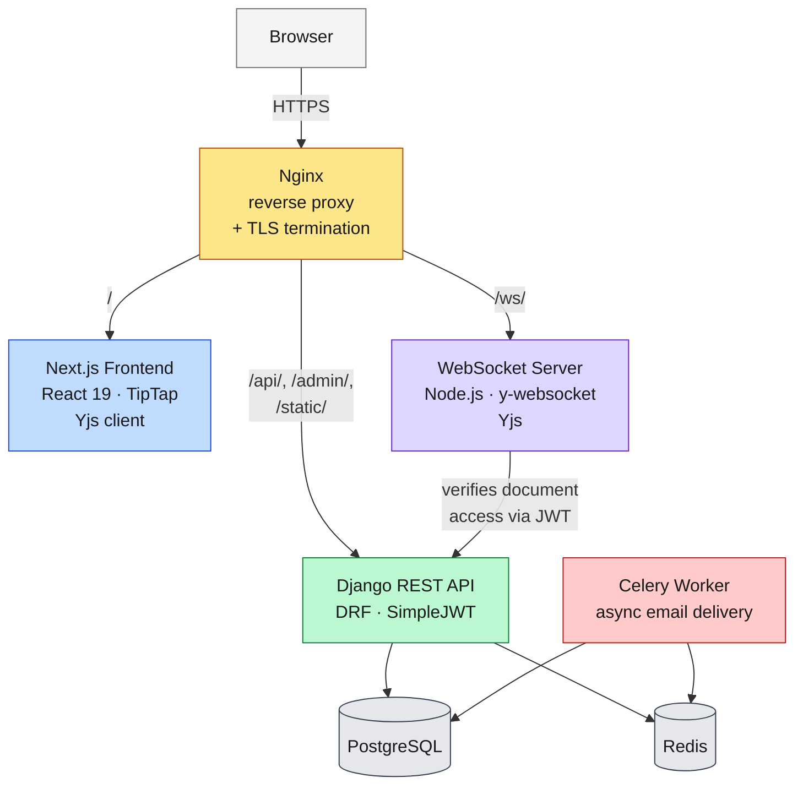

# Editly

**Create. Edit. Collaborate.**

A real-time collaborative document editor built for teams to write, organize, and manage documents together — with live multi-cursor editing, presence indicators, and role-based document sharing.

🔗 **Live demo:** [https://editly-app.duckdns.org](https://editly-app.duckdns.org)

---

## 🧪 Try It Yourself

Two demo accounts are set up so you can see real-time collaboration without creating your own account:

| Role | Email | Password |
|---|---|---|
| Owner (Account A) | `TBD` | `TBD` |
| Collaborator (Account B) | `TBD` | `TBD` |

**Suggested walkthrough:**
1. Log in as **Account A** in one browser tab, and **Account B** in a private/incognito window (or a second browser).
2. As Account A, open **"Getting Started"** (or any shared document) from the dashboard.
3. Watch Account B's cursor and edits appear live in Account A's tab, and vice versa — no refresh needed.
4. Browse the document list to see search and pagination in action (~25 seeded documents).

> These are public demo accounts — please don't enter real personal information. Content may be periodically reset.

---

## 🎬 Screenshots & Demo

<!--
Add a short GIF here showing live-cursor sync in action — this is the single highest-impact
addition you can make. A 10-15 second screen recording (record it, then convert to GIF) showing
two browser windows editing the same document side by side does more than any amount of text.

Tools: ScreenToGif (Windows), Kap (Mac), or record with OBS/Loom and convert with ezgif.com.
Once you have the file, drop it in a `docs/` or `assets/` folder in the repo and reference it below:


-->


---

## ✨ Features

- **Real-time collaborative editing** — powered by [Yjs](https://github.com/yjs/yjs) CRDTs, so multiple people can edit the same document simultaneously with automatic, conflict-free merging
- **Live presence & cursors** — see who's online in a document right now, and where their cursor is, as they type
- **Document sharing & roles** — invite collaborators by email with owner/editor roles; invites are tracked through an accept flow
- **Rich text editing** — built on [TipTap](https://tiptap.dev/), with formatting, alignment, lists, task lists, and more
- **Authentication** — JWT-based auth (access + refresh tokens) with account registration, login, and profile management
- **Document search & pagination** — find documents quickly across a paginated library
- **Async email delivery** — account and invite emails handled by a background Celery worker, so the request/response cycle stays fast

---

## 🏗️ Architecture

Editly runs as seven containerized services behind a single Nginx reverse proxy, orchestrated with Docker Compose.



**How a live edit actually reaches another user:**
1. The browser opens a WebSocket connection to `/ws/<document-id>`, carrying the user's JWT.
2. The Node WebSocket server verifies that token against the Django API before allowing the connection — access control lives in one place (Django), not duplicated in the WebSocket layer.
3. Once verified, keystrokes are synced as Yjs CRDT updates, broadcast to every other connected client in that document's "room," with no central lock or conflict resolution needed.
4. Presence and cursor position are synced the same way, over a separate awareness channel.

---

## 🧰 Tech Stack

| Layer | Technology |
|---|---|
| Frontend | Next.js 16, React 19, TypeScript, TipTap, Yjs, Tailwind |
| Backend | Django 5.1, Django REST Framework, SimpleJWT, drf-spectacular |
| Real-time sync | Node.js, `ws`, `y-websocket`, `y-protocols` |
| Database | PostgreSQL 16 |
| Cache / broker | Redis 7 |
| Async tasks | Celery |
| Reverse proxy | Nginx |
| Infrastructure | Docker Compose, AWS EC2, Let's Encrypt (Certbot) |

---

## 📁 Project Structure

This is a monorepo containing all four services, each independently containerized:

```
editly/
├── Backend/      # Django REST API
├── Frontend/     # Next.js application
├── WebSocket/    # Node.js real-time sync server
├── Nginx/        # Reverse proxy configuration
└── docker-compose.prod.yml
```

---

## 🚀 Running Locally

```bash
git clone https://github.com/sumitbansode360/EditlyMono.git
cd EditlyMono
docker compose up --build
```

Requires Docker and Docker Compose. See `.env.example` for required environment variables.

---

## ⚠️ Known Limitations

- **Single-instance deployment** — the app runs on one EC2 instance with no horizontal scaling or load balancing; the WebSocket server in particular would need a shared pub/sub layer (e.g. Redis adapter) to run multiple instances behind a load balancer.
- **AWS Free Tier window** — the current EC2 instance is on the 6-month free tier; after that, hosting will move to a paid instance or a cheaper always-free alternative.
- **No automated CI/CD** — deployments are done manually via SSH + `docker compose up --build`; a GitHub Actions pipeline is a natural next step.
- **No automated test suite yet** — collaboration edge cases (reconnect handling, offline edits) have been tested manually rather than with integration tests.

---

## 📌 Notes on This Deployment

This project is deployed on a single AWS EC2 instance with a hand-configured, self-renewing TLS setup — a two-phase Let's Encrypt bootstrap (HTTP-01 challenge via Nginx webroot, followed by a Certbot-issued certificate mounted into Nginx), with automatic renewal via cron. No managed proxy (e.g. Cloudflare) sits in front of it — encryption is genuinely end-to-end to the origin server.

---

## 📄 License

MIT — free to use, modify, and reuse.
